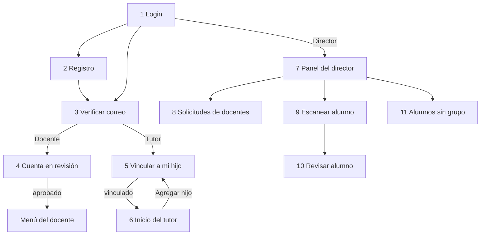

# AulaSegura: pantallas actualizadas y nuevas

> Contexto para el agente de código (OpenCode). Complementa `AulaSegura-registro-vinculacion.md`, que describe el flujo, el modelo de datos y las reglas de seguridad. Este archivo lista **qué pantallas se modifican y cuáles se crean** por el cambio de registro, aprobación y vinculación.
> Cada pantalla es un Fragment dentro de una sola `MainActivity` con Navigation Component. Material Design 3. Todo el texto de la interfaz va en español.

## Resumen

| # | Pantalla | Rol | Estado |
| --- | --- | --- | --- |
| 1 | Login | Todos | Actualizada |
| 2 | Registro (pestañas Tutor y Docente) | Tutor y docente | Nueva |
| 3 | Verificar correo | Tutor y docente | Nueva |
| 4 | Cuenta en revisión (y rechazada) | Docente | Nueva |
| 5 | Vincular a mi hijo (QR) | Tutor | Nueva |
| 6 | Inicio del tutor | Tutor | Actualizada |
| 7 | Panel del director | Director | Actualizada |
| 8 | Solicitudes de docentes | Director | Nueva |
| 9 | Escanear alumno | Director | Nueva |
| 10 | Revisar alumno | Director | Nueva |
| 11 | Alumnos sin grupo | Director | Nueva |

Sin cambios: pase de lista del docente, registro de incidentes con cámara y el resto de las pantallas ya existentes (tareas, avisos, reportes).

## Estilo visual (tokens del diseño ya aprobado)

- Fondo crema `#FCF9F4` con patrón sutil de escudos al 5 % de opacidad.
- Primario índigo `#141761`; contenedor primario `#2B2F77`; acento coral `#FC6955` (botón principal y badges); coral claro `#FFDAD4` (chips); rojo oscuro `#AE3123` (enlaces); verde `#3AB492` y `#004031` (solo el ícono del escudo).
- Superficies blancas, bordes `#C7C5D2` al 40 %, índigo suave `#E0E0FF` para zonas informativas.
- Tipografías: Bricolage Grotesque (títulos), DM Sans (cuerpo, etiquetas, botones), JetBrains Mono (textos de ayuda pequeños).
- Campos de 52 dp de alto con esquinas de 16 dp; botón principal en píldora de 48 dp.
- Barra superior: botón circular de regreso a la izquierda y una píldora central con el escudo verde y el texto "AulaSegura".

La referencia visual es el HTML exportado de Stitch (`registro-aulasegura.html`). Tomar de ahí colores, tipografías y medidas; la implementación real va en Android (Material 3), no en HTML.

---

## 1. Login — ACTUALIZADA

- **Cambio:** quitar la fila de chips "Padre / Alumno · Docente · Administrador". El rol ya no se elige: se lee de `users/{uid}.rol` al iniciar sesión.
- **Cambio:** el enlace inferior pasa a "¿No tienes cuenta? Regístrate como tutor o docente" y lleva al Registro.
- **Después de iniciar sesión, la app redirige según el estado:**
  - Correo sin verificar → pantalla 3.
  - Docente `pendiente` o `rechazado` → pantalla 4.
  - Tutor con `vinculacion` ≠ `vinculado` → pantalla 5.
  - Tutor `vinculado` → pantalla 6.
  - Docente `aprobado` → menú del docente.
  - Director → pantalla 7.

## 2. Registro (Tutor / Docente) — NUEVA

- Un solo Fragment con un **control segmentado** (Tutor | Docente) que cambia los campos visibles.
- **Campos comunes:** nombre completo, correo electrónico (con la nota "Usa un correo real: te enviaremos un enlace de verificación"), teléfono (prefijo +52), contraseña con medidor de seguridad de 4 segmentos, confirmar contraseña, casilla de aviso de privacidad y términos.
- **Foto de perfil:** opcional, con avatar circular y botón de cámara.
- **Pestaña Tutor:** agrega "Nombre completo de tu hijo" (etiqueta "Para tu código QR"). **No existe el campo del código del alumno.** Botón: "Crear cuenta".
- **Pestaña Docente:** agrega "Materia o grado que impartes" y un aviso "Tu cuenta será revisada". Botón: "Enviar solicitud".
- **Al enviar:** crea la cuenta en Firebase Authentication, envía `sendEmailVerification()` y guarda `users/{uid}`:
  - Tutor: `rol = tutor`, `estado = activo`, `vinculacion = pendiente`, `hijoSolicitado`.
  - Docente: `rol = docente`, `estado = pendiente`.
- **Navega a:** pantalla 3.

## 3. Verificar correo — NUEVA

- Ilustración de sobre con palomita, título "Revisa tu correo" y el correo del usuario en el texto.
- Botón principal "Ya verifiqué mi correo": llama a `reload()` y revisa `isEmailVerified`. Si aún no está verificado, muestra un mensaje.
- Botón secundario "Reenviar correo" y texto "Cerrar sesión".
- Sin barra de navegación inferior.
- **Navega a:** pantalla 4 (docente) o pantalla 5 (tutor).

## 4. Cuenta en revisión — NUEVA

- Aplica al docente con `estado = pendiente`. Título "Tu cuenta está en revisión", texto explicativo y chip naranja "Pendiente de aprobación".
- Botón "Actualizar estado" (vuelve a leer `users/{uid}`) y "Cerrar sesión". Sin barra de navegación inferior.
- **Variante rechazada** (`estado = rechazado`): chip rojo "Solicitud rechazada" y el mensaje "Contacta a la escuela para más información".
- Cuando el estado cambia a `aprobado`, navega al menú del docente.

## 5. Vincular a mi hijo (QR) — NUEVA

- Aplica al tutor con correo verificado y `vinculacion` ≠ `vinculado`.
- Chip naranja "Pendiente de vinculación".
- Tarjeta blanca con un **código QR grande** y el texto "Alumno: {hijoSolicitado}". El QR codifica un JSON con versión, `uid` del tutor y nombre del alumno (por ejemplo `{"v":1,"uid":"...","alumno":"..."}`) y se genera en el dispositivo (ZXing), sin conexión.
- Tres pasos numerados: "Preséntate con la directora", "Muestra este código QR", "Ella lo escaneará y vincularemos a tu hijo".
- Botón de texto "Corregir nombre del alumno".
- **Escucha en tiempo real** su documento `users/{uid}`:
  - `vinculacion = vinculado` → navega a la pantalla 6.
  - `vinculacion = rechazada` → muestra el mensaje y permite corregir el nombre y generar un QR nuevo.
- Sin barra de navegación inferior.

## 6. Inicio del tutor — ACTUALIZADA

- **Cambio:** fila de chips para cambiar entre hijos ("Luis", "Ana") y un chip final "+ Agregar hijo". "Agregar hijo" abre la pantalla 5 para generar un QR nuevo.
- **Cambio:** si el alumno no tiene grupo, mostrar el chip naranja "Grupo por asignar" junto al grupo y la asistencia como "Sin datos aún".
- Se mantiene el resto: tarjeta del alumno, resumen (faltas, tareas pendientes, avisos), próximas tareas y último aviso.
- La lista de hijos sale de `students` donde `tutores` contiene el `uid` del tutor.

## 7. Panel del director — ACTUALIZADA

- **Cambio:** dos tarjetas de acción al inicio: "Solicitudes de docentes: N pendientes" (botón "Revisar", lleva a la pantalla 8) y "Alumnos sin grupo: N" (botón "Asignar", lleva a la pantalla 11).
- **Cambio:** botón de acción flotante extendido con ícono de QR y el texto "Escanear alumno" (lleva a la pantalla 9).
- **Cambio:** barra de navegación inferior: Panel, Solicitudes (con insignia del número de pendientes), Alumnos, Reportes, Ajustes.
- Se mantienen las tarjetas de métricas, la gráfica de asistencia por grupo y la lista de alumnos con más faltas.

## 8. Solicitudes de docentes — NUEVA

- Barra superior con acción de texto "Aceptar todas".
- Chips de filtro: Pendientes (N), Aceptadas, Rechazadas.
- Lista de tarjetas: avatar, nombre, correo con marca "verificado", materia o grado, "Solicitado hace X" y los botones **Rechazar** (contorno rojo) y **Aceptar** (relleno).
- Solo se listan docentes con el correo verificado.
- **Acciones:** actualizar `users/{uid}.estado` a `aprobado` o `rechazado`. "Aceptar todas" usa una escritura en lote.

## 9. Escanear alumno — NUEVA

- Pantalla completa con la vista previa de la cámara, un marco cuadrado con esquinas redondeadas y una línea de escaneo.
- Barra superior transparente con regreso, título "Escanear alumno" y botón de linterna. Texto "Apunta al código QR del tutor".
- **Permiso de cámara:** si no está concedido, mostrar la explicación "Necesitamos la cámara para escanear el QR del tutor", con los botones "Permitir cámara" y "Ahora no".
- Valida el formato del QR (versión, `uid`, nombre). Si no es válido: "QR no válido" y no se guarda nada.
- **Navega a:** pantalla 10 con los datos leídos.

## 10. Revisar alumno — NUEVA

- Tarjeta **Alumno** (nombre completo) y tarjeta **Tutor** (nombre, correo y chip verde "Correo verificado").
- Selectores de **Grado** (1° a 6°) y **Grupo** (A a F) y la casilla "Dejar sin grupo por ahora".
- Tarjeta amarilla de advertencia si ya existe un alumno con el mismo nombre, con el botón "Vincular como segundo tutor".
- Botones: **Rechazar** (contorno rojo) y **Aceptar** (relleno).
- **Aceptar:** crea `students/{id}` con `tutores = [uid]`, `grado`, `grupo` (vacíos si queda sin grupo), `activo = true`, `creadoPor` y `syncStatus`; pone `users/{uid}.vinculacion = vinculado`. Con el segundo tutor, agrega el `uid` a `tutores` del alumno existente.
- **Rechazar:** pone `users/{uid}.vinculacion = rechazada`.
- Funciona sin conexión: guarda en Room con `syncStatus = PENDIENTE` y WorkManager sincroniza al volver la señal.

## 11. Alumnos sin grupo — NUEVA

- Barra superior con título, subtítulo "N alumnos" y acción "Seleccionar todos". Campo de búsqueda.
- Lista con casilla de selección, avatar, nombre del alumno y nombre del tutor.
- Barra inferior fija al seleccionar: "N seleccionados", selectores de grado y grupo (A a F) y el botón "Asignar grupo".
- **Acción:** actualiza `grado` y `grupo` de los alumnos seleccionados en lote.

---

## Mapa de navegación

