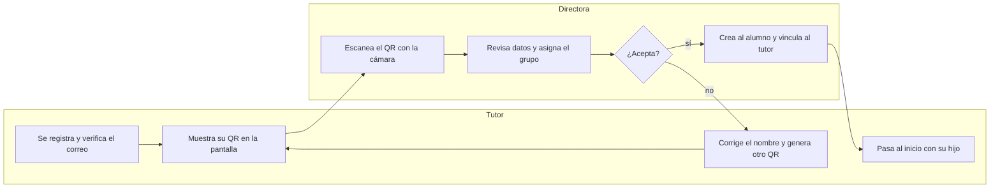

# AulaSegura: registro, aprobación y vinculación

> Contexto para el agente de código (OpenCode). App Android (Kotlin) con Firebase (Authentication, Firestore, Storage), Room y WorkManager, Material Design, Fragments y Navigation. Una sola APK con tres roles: tutor, docente y director.
> Este documento describe el cambio a implementar en el registro y el alta de docentes y alumnos. Si algo contradice el código actual, este documento es la referencia del comportamiento esperado.

El director deja de dar de alta a docentes y alumnos uno por uno: los docentes piden acceso y el director los aprueba, y cada tutor registra a su hijo con un QR que la directora escanea.

## Qué cambia

La profesora observó que, en una escuela real, dar de alta uno por uno a cientos de docentes y alumnos es inviable para el director. El cambio traslada la captura a quienes tienen los datos, y el director solo revisa y aprueba.

| Aspecto | Antes | Ahora |
| --- | --- | --- |
| Alta de docentes | El director los crea uno por uno | El docente se registra solo y el director lo acepta o rechaza |
| Alta de alumnos | El director captura cada alumno | El tutor registra a su hijo y la directora escanea un QR para aprobarlo |
| Grupo del alumno | Se capturaba al crear el alumno | La directora lo asigna al escanear, o después, en lote |
| Código del alumno | Obligatorio para registrar al tutor | Ya no existe: el correo verificado del tutor basta |
| Rol del director | Capturista | Revisor y aprobador |

El alta y baja individual se conserva como función secundaria, para corregir un registro puntual.

## Roles y estados de cuenta

La pantalla de registro ofrece dos opciones: **Tutor** y **Docente**. No existe registro público para el director, cuya cuenta se crea de forma manual en Firebase.

| Rol | Cómo entra | Estado inicial | Quién lo cambia |
| --- | --- | --- | --- |
| Tutor | Se registra con correo real y verifica el correo | `activo` | Nadie; queda vinculado cuando la directora aprueba al alumno |
| Docente | Se registra con correo real y completa sus datos | `pendiente` | El director lo pasa a `aprobado` o `rechazado` |
| Director | Cuenta creada manualmente | `aprobado` | No aplica |

Qué ve cada docente según su estado:

- `pendiente`: una pantalla "Tu cuenta está en revisión", sin acceso a ninguna otra.
- `aprobado`: su menú normal de docente.
- `rechazado`: un mensaje de rechazo con la opción de cerrar sesión.

## Flujo del docente: registro y aprobación

1. En la pantalla de registro, el docente elige la pestaña **Docente**.
2. Escribe su correo real y completa sus datos (nombre, teléfono y materia o grado que imparte) y su contraseña.
3. La app crea la cuenta en Firebase Authentication y envía el correo de verificación (`sendEmailVerification`).
4. La app guarda `users/{uid}` con `rol = docente` y `estado = pendiente`.
5. El docente ve la pantalla "Tu cuenta está en revisión". Al abrir la app, la app revisa su estado y lo redirige según corresponda.
6. En el panel del director aparece la lista **Solicitudes de docentes**, con nombre, correo y fecha. El director toca **Aceptar** o **Rechazar**; también puede aceptar varias a la vez.
7. Al aceptar, el estado pasa a `aprobado` y el docente accede a su menú. Al rechazar, pasa a `rechazado`.

Solo entran a la lista de solicitudes los docentes con el correo verificado. Así el director ve únicamente correos reales.

## Flujo del tutor y del alumno

El tutor es el único que necesita cuenta para entrar a ver a su hijo. El alumno no tiene cuenta: es un registro que la directora crea al escanear el QR del tutor.

Si la directora rechaza, el tutor corrige el nombre y genera un QR nuevo; si acepta, el tutor pasa directo a su inicio.

### Paso a paso

1. **Registro del tutor.** En la pestaña **Tutor** escribe su nombre, teléfono, correo real, contraseña y el **nombre completo de su hijo**.
2. **Verificación del correo.** La app crea la cuenta y envía el correo de verificación. Hasta que el tutor lo confirme (la app usa `reload()` y `isEmailVerified`), no avanza.
3. **Pantalla "Pendiente de vinculación".** Con el correo verificado, la app muestra un **código QR** grande y el texto "Preséntate con la directora para vincular a tu hijo". El QR contiene el identificador del tutor (`uid`) y el nombre del alumno.
4. **Escaneo en la escuela.** La directora abre **Escanear alumno** en su panel (la app pide el permiso de cámara) y escanea el QR del tutor.
5. **Revisión.** La app muestra el nombre del alumno, el nombre y el correo del tutor, la marca de correo verificado y un selector de **grado y grupo (A a F)** con la opción **Sin grupo**. Si ya existe un alumno con ese nombre, avisa y ofrece **vincular como segundo tutor** en lugar de crear un duplicado.
6. **Aceptar o rechazar.** Al aceptar, se crea el alumno con el tutor vinculado y la vinculación del tutor pasa a `vinculado`. Al rechazar (por ejemplo, el nombre está mal escrito), pasa a `rechazada`.
7. **Resultado en el celular del tutor.** La app escucha su propio documento de usuario. Si queda `vinculado`, lo lleva al **inicio con su hijo ya vinculado** (asistencia, tareas, avisos e incidentes). Si queda `rechazada`, puede corregir el nombre y generar un QR nuevo.
8. **Asignar grupo después.** Un alumno sin grupo aparece en el filtro **Alumnos sin grupo** del director, que puede seleccionar varios y asignarles un grupo de una sola vez. Mientras tanto, el tutor ve "Grupo por asignar".

Si el tutor tiene más hijos, desde su inicio toca **Agregar otro hijo**, escribe el nombre y se genera un QR nuevo que la directora escanea igual.

### Por qué ya no hace falta el código

La seguridad de la vinculación descansa en tres cosas: el correo está verificado, la directora ve al tutor en persona y es ella quien aprueba. Con eso, el código aleatorio sería un paso extra sin una ventaja real.

## Modelo de datos

Se agregan campos a `users` y `students`; no hace falta una colección nueva. Los mismos campos se reflejan en las entidades de Room, junto con `syncStatus` y `updatedAt`.

### users/{uid}

| Campo | Tipo | Para qué sirve |
| --- | --- | --- |
| `rol` | texto | `tutor`, `docente` o `director` |
| `estado` | texto | Docentes: `pendiente`, `aprobado` o `rechazado`. Tutores: `activo` |
| `nombre`, `telefono`, `correo` | texto | Datos de contacto |
| `hijoSolicitado` | texto | Nombre del hijo capturado en el registro del tutor (aparece en el QR) |
| `vinculacion` | texto | Solo tutores: `pendiente`, `vinculado` o `rechazada` |
| `fechaSolicitud` | fecha | Para ordenar la lista de solicitudes del director |

### students/{id}

| Campo | Tipo | Para qué sirve |
| --- | --- | --- |
| `nombre` | texto | Nombre completo del alumno |
| `tutores` | lista de uid | Uno o dos tutores vinculados |
| `grado`, `grupo` | texto | Se dejan vacíos si el alumno está "Sin grupo" |
| `activo` | booleano | Permite dar de baja sin borrar el historial |
| `creadoPor` | uid | La directora que aprobó el alta |
| `syncStatus`, `updatedAt` | texto, fecha | Control de sincronización con Room |

Se elimina el campo del código del alumno y el campo obligatorio del código en el registro del tutor.

## Reglas de seguridad y validaciones

Validar solo en la interfaz no basta: las reglas de Firestore deben impedir que alguien se apruebe a sí mismo o se vincule a un alumno ajeno.

| Qué se protege | Regla |
| --- | --- |
| Rol y estado al registrarse | Un usuario solo puede crear su documento con `rol` = `tutor` o `docente`, y con `estado` = `activo` (tutor) o `pendiente` (docente). Nunca como director |
| Cambio de estado | Solo el director puede cambiar `estado` y `vinculacion` de otros usuarios; nadie modifica el suyo |
| Correo verificado | Las operaciones del tutor y del docente exigen `request.auth.token.email_verified == true` |
| Alta de alumnos | Solo el director puede crear, editar o dar de baja documentos de `students` |
| Lectura de alumnos | Un tutor solo lee los alumnos donde su `uid` está en `tutores`; un docente, los de sus grupos |
| Solicitudes pendientes | Un docente en estado `pendiente` no puede leer ni escribir datos escolares |

Validaciones en la app:

- No mostrar el QR hasta que el correo esté verificado.
- El director escanea solo con permiso de cámara concedido; si lo niega, la app explica para qué lo necesita.
- Detectar duplicados por nombre al escanear y ofrecer vincular como segundo tutor.
- Comprobar que el QR tenga el formato esperado (versión, `uid` y nombre) antes de procesarlo; un QR ajeno se ignora.

## Casos especiales y funcionamiento sin conexión

| Situación | Qué hace la app |
| --- | --- |
| El tutor escribió mal el nombre del hijo | La directora rechaza; el tutor corrige el nombre y genera un QR nuevo. También puede corregirlo la directora al revisar |
| Madre y padre quieren vincularse al mismo alumno | La directora ve el aviso de duplicado y elige "vincular como segundo tutor" |
| El tutor tiene varios hijos | Desde su inicio toca "Agregar otro hijo" y se genera un QR por cada uno |
| El alumno aún no tiene grupo | Queda en "Sin grupo"; la directora lo asigna después, en lote. El tutor ve "Grupo por asignar" |
| El docente nunca fue aprobado | Permanece en la pantalla de revisión; el director puede aceptarlo cuando quiera |
| Dar de baja a un alumno o docente | Se marca `activo = false` o `estado = rechazado`; el historial de asistencia se conserva |
| Se escanea un QR inválido | Se muestra "QR no válido" y no se guarda nada |

Sin conexión (Room y sincronización):

- El tutor necesita internet para registrarse y verificar su correo, porque eso lo hace Firebase Authentication.
- Una vez que el QR está en pantalla, no requiere internet. Los datos viajan dentro del QR.
- La directora puede escanear y aprobar sin conexión: el alumno se guarda en Room con `syncStatus = PENDIENTE` y se sube a Firestore con WorkManager al volver la señal.
- Hasta que se sincronice, el tutor no verá a su hijo vinculado; el director ve en la ficha del alumno el indicador "pendiente de sincronizar".
- Si la directora aprueba sin conexión, la regla de correo verificado se comprueba cuando el registro llega a Firestore. Un registro que no cumpla se marca `ERROR` y se avisa en pantalla.
